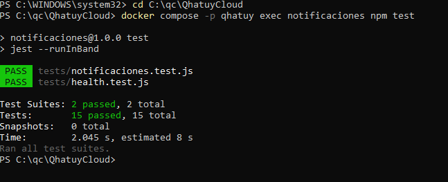
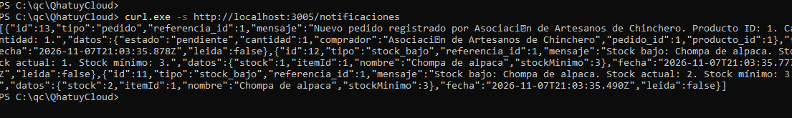
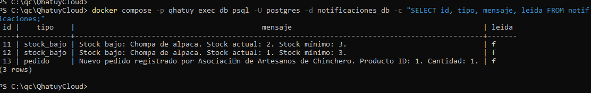
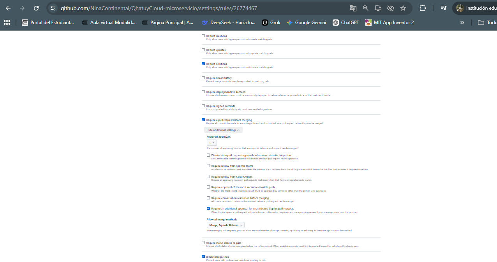

# QhatuyCloud-microservicio

Airton Waldir Nina Meza 

Frank Luis Gomez Cornejo

Jorcaef Vicente Rivera Cusihuaman

Iarley Josue Ranirez LLigua

Grimaldo Huacho Criollo


# Proyecto: QhatuyCloud


### 1. Proyecto


**QhatuyCloud** – Sistema de gestión de inventario y pedidos para artesanos textiles del Cusco.

---

### 2. Problema


En Chinchero y San Blas, las asociaciones de artesanos manejan su inventario en cuadernos, causando desabastecimiento de insumos (lana o tintes) y retrasos en las entregas por falta de visibilidad del stock entre talleres.

---

### 3. Usuarios


* **Artesanos:** Conectados desde smartphones básicos con datos limitados.


* **Tiendas y Mayoristas:** Compradores de productos terminados en Cusco.


* **Líderes de Asociación:** Coordinadores de producción y pedidos.


---

### 4. Solución


Plataforma ligera en la nube que permite a los artesanos actualizar stock e insumos desde su celular, agrupando pedidos automáticos y calculando tiempos de entrega.

---

### 5. Microservicios


| Servicio | Responsabilidad |
| --- | --- |
| **Artesanos** | Registro de productores, talleres y datos de contacto.

 |
| **Inventario** | Catálogo de productos terminados, insumos y alertas de bajo stock.

 |
| **Pedidos** | Registro de compras, validación contra stock y estado de entrega.

 |
| **Producción** | Asignación de tareas a talleres y seguimiento de avance de fabricación.

 |
| **Notificaciones** | Registro y consulta de avisos internos de pedido nuevo y stock bajo (envío por SMS/WhatsApp previsto como mejora futura). |

---

## 7. Pruebas

Las pruebas usan Jest y Supertest contra la base de datos PostgreSQL de cada servicio. Se ejecutan con:

```bash
docker compose exec <servicio> npm test
```
7.1 Microservicio Artesanos

El microservicio Artesanos funciona en el puerto 3001 y se encarga de gestionar la información de los productores textiles, talleres y sus datos de contacto. Permite centralizar la información de los artesanos para facilitar su identificación y participación en las actividades de producción.

Pruebas realizadas:

Se ejecutaron tres pruebas automatizadas para verificar el funcionamiento del microservicio, incluyendo su disponibilidad y el comportamiento de las operaciones implementadas.

Las pruebas verifican que el servicio responda correctamente, procese las solicitudes y gestione adecuadamente los datos recibidos.

Resultado: 3 de 3 pruebas aprobadas.

Comando utilizado:

docker compose exec artesanos npm test


7.2 Microservicio Inventario

El microservicio Inventario funciona en el puerto 3002 y administra el catálogo de productos terminados e insumos utilizados por los artesanos. Permite consultar artículos, actualizar existencias y detectar productos con bajo stock. También comunica las alertas al microservicio Notificaciones.

Pruebas realizadas:

GET /health: verifica la disponibilidad del servicio. Se espera una respuesta 200 con estado ok.
POST /items: verifica el registro de artículos. Se espera que el artículo se guarde y pueda consultarse por su ID.
POST /items: comprueba que se rechacen tipos de artículos no permitidos. Se espera una respuesta 400.
PATCH /items//stock: verifica el control de existencias cuando se intenta descontar más stock del disponible. Se espera una respuesta 409 y que el stock no cambie.
GET /alertas/bajo-stock: verifica la identificación de artículos cuya existencia está por debajo del mínimo establecido.
Resultado: 5 de 5 pruebas aprobadas.

Comando utilizado:

docker compose exec inventario npm test


7.3 Microservicio Pedidos

El microservicio Pedidos funciona en el puerto 3003 y registra las compras realizadas por tiendas, mayoristas y asociaciones de artesanos. Verifica la disponibilidad de productos mediante Inventario, descuenta las existencias y envía notificaciones. Cuando un pedido es confirmado, comunica la información al microservicio Producción.

Pruebas realizadas:
GET /health: verifica la disponibilidad del servicio. Se espera una respuesta 200.
GET /pedidos: comprueba la consulta general de pedidos. Se espera una lista de registros.
POST /pedidos: verifica el rechazo de datos incompletos. Se espera una respuesta 400.
POST /pedidos: comprueba el registro de un pedido, el descuento de stock y el envío de una notificación. Se espera una respuesta 201.
POST /pedidos: verifica que el pedido se conserve cuando falla el servicio de Notificaciones y que se informe del inconveniente.
POST /pedidos: comprueba el rechazo de pedidos sin stock suficiente. Se espera una respuesta 409.
POST /pedidos: verifica el rechazo de productos inexistentes. Se espera una respuesta 404.
PATCH /pedidos//estado: comprueba la actualización del estado y la comunicación con Producción cuando el pedido se confirma. Se espera una respuesta 200.
PATCH /pedidos//estado: verifica que se conserve el estado anterior si Producción rechaza la solicitud. Se espera una respuesta 502.
PATCH /pedidos//estado: comprueba el rechazo de estados no permitidos. Se espera una respuesta 400.
Resultado: 10 de 10 pruebas aprobadas.

Comando utilizado:

docker compose exec pedidos npm test


7.4 Microservicio Producción

El microservicio Producción funciona en el puerto 3004 y administra el seguimiento de fabricación de los pedidos confirmados. Recibe información desde Pedidos, registra órdenes de producción, permite consultar sus datos y actualizar sus estados.

Pruebas realizadas:

GET /health: verifica la disponibilidad del servicio. Se espera una respuesta 200.
POST /produccion: comprueba el registro de una orden de producción. Se espera una respuesta 201 y el estado inicial pendiente.
POST /produccion: verifica el rechazo de información incompleta. Se espera una respuesta 400.
POST /produccion: comprueba el rechazo de cantidades negativas. Se espera una respuesta 400.
POST /produccion: verifica que no se registren órdenes duplicadas para un mismo pedido. Se espera una respuesta 409.
GET /produccion: comprueba la consulta general de órdenes. Se espera una respuesta 200 con una lista.
GET /produccion/:id: verifica la consulta de una orden existente. Se espera una respuesta 200 con sus datos.
GET /produccion/:id: comprueba la respuesta ante una orden inexistente. Se espera una respuesta 404.
PATCH /produccion//estado: verifica la actualización de estados y el rechazo de estados inválidos. Se esperan respuestas 200 y 400, respectivamente.
Prueba de comunicación con Pedidos: verifica el manejo de errores cuando no se puede completar la comunicación requerida. Se espera una respuesta 503.
Resultado: 10 de 10 pruebas aprobadas.

Comando utilizado:
docker compose exec produccion npm test


### 7.5 Notificaciones

Puerto 3005, base de datos `notificaciones_db`. Recibe los avisos de pedido nuevo (desde Pedidos) y de stock bajo (desde Inventario), los valida y los guarda en PostgreSQL. Detalle de endpoints y base de datos en [notificaciones/README.md](notificaciones/README.md).

| Prueba | Funcionalidad que verifica | Microservicio | Comportamiento esperado |
|---|---|---|---|
| GET /health debe responder correctamente | Disponibilidad | Notificaciones | 200 con `{ servicio: "notificaciones", estado: "ok" }` |
| registra una notificación de pedido nuevo | Aviso desde Pedidos | Notificaciones | 201, tipo `pedido`, mensaje correcto, `leida` en false y datos originales guardados |
| rechaza datos incompletos con 400 | Validación de pedido | Notificaciones | 400 con detalle de los errores; no se guarda nada |
| rechaza cantidad cero o comprador vacío | Validación de pedido | Notificaciones | 400 |
| registra una alerta con el formato de Inventario | Alerta desde Inventario | Notificaciones | 201, tipo `stock_bajo`, respeta el contrato `itemId`, `nombre`, `stock`, `stockMinimo` |
| acepta stock igual a cero | Validación de stock bajo | Notificaciones | 201 |
| rechaza datos inválidos con 400 | Validación de stock bajo | Notificaciones | 400 con stock negativo, `itemId` no numérico o sin `stockMinimo` |
| GET /notificaciones devuelve una lista | Consulta general | Notificaciones | 200 con un arreglo ordenado de la más reciente a la más antigua |
| GET /notificaciones?tipo=stock_bajo filtra por tipo | Filtro por tipo | Notificaciones | Solo devuelve avisos `stock_bajo` |
| GET /notificaciones/:id devuelve una notificación | Consulta por id | Notificaciones | 200 con el registro |
| GET /notificaciones/:id devuelve 404 si no existe | Registro inexistente | Notificaciones | 404 |
| GET /notificaciones/:id con id no numérico devuelve 400 | Validación de id | Notificaciones | 400 |
| marca la notificación como leída | PATCH leída | Notificaciones | 200 y `leida` en true al volver a consultar |
| PATCH devuelve 404 si no existe | Registro inexistente | Notificaciones | 404 |
| la notificación persiste en PostgreSQL | Persistencia | Notificaciones | El registro se lee desde otra conexión a la base de datos |

**Resultado de las pruebas** (`docker compose exec notificaciones npm test`): 15 de 15 pruebas aprobadas.



**Avisos consultados por la API** (`curl http://localhost:3005/notificaciones`): dos alertas de stock bajo enviadas por Inventario y un aviso de pedido nuevo enviado por Pedidos.



**Datos guardados en PostgreSQL** (`notificaciones_db`):



> Alcance: los avisos se almacenan y se consultan por la API. En esta versión no se envían mensajes reales por WhatsApp, SMS ni correo.

---

8. Flujo de trabajo del equipo

- Repositorio central público administrado por el líder del equipo.
- Cada integrante trabaja en su propio fork (o en una rama propia, en el caso del líder) y propone sus cambios mediante Pull Requests hacia `main`.
- Antes de fusionar, cada Pull Request se revisa y el pipeline de GitHub Actions ejecuta las pruebas y la construcción de las imágenes Docker.

**Protección de la rama `main`** (regla `proteger-main`, activa y sin excepciones):

- **Require a pull request before merging** con **1 aprobación**: ningún cambio entra a `main` sin Pull Request aprobado.
- **Block force pushes**: no se puede reescribir el historial de `main`.
- **Restrict deletions**: no se puede eliminar la rama `main`.


